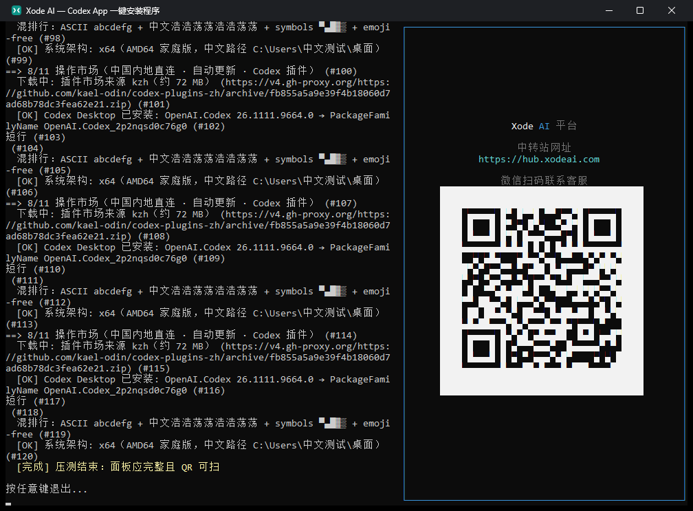

# Codex App（ChatGPT Desktop）一键安装程序（国内网络优化版）

Windows 上绕过网络限制，一键安装并配置 Codex App——即 **ChatGPT 桌面应用**（包名 `OpenAI.Codex`，Microsoft Store 名 ChatGPT；**Codex 是其中的一种模式**）。现在一条龙完成：**安装 + sub2api 自动登录建 Key + Codex 配置 + 简体中文汉化**。

## 快速开始

双击 [CodexAppInstaller.exe](https://raw.githubusercontent.com/l1i1/CodexAppInstaller/main/CodexAppInstaller.exe)，**启动后先输入 sub2api 站点账号密码（验证通过才继续）**，然后 UAC 弹窗点"是"，其余全程自动：

1. 登录 sub2api 站点验证账号（站点固定为 `https://hub.xodeai.com`）
2. 自动下载 Codex MSIX（镜像加速，SHA256 校验，带缓存）并静默安装
3. 自动创建/复用 API Key「codex桌面端」（站点后台可见）
4. 按 sub2api 官方模板写入 `~/.codex/config.toml`（合并式生成，保留已装插件与自定义配置）：联网搜索=live、**Full Access**、记忆=开、启动更新检查=关
5. 汉化（双轨自适应）：新版 Codex → [汉化启动器](https://github.com/shibaweidu/codex-desktop-zh)（原生 i18n 注入）；旧版 → [codex-zh-CN](https://github.com/xqnode/codex-zh-CN) 补丁副本（含兼容补丁），均走国内线路
6. 内置统一插件市场「Codex 插件」——192 个官方插件全量汉化（[kael-odin/codex-plugins-zh](https://github.com/kael-odin/codex-plugins-zh)）+ 暴喵精选「中文学术研究工具箱」（[baomiao-codex-skills-marketplace](https://github.com/tetexu1994-star/baomiao-codex-skills-marketplace)），国内直连安装，版本锁定
7. Xode AI 品牌化：安装器图标/窗口标题、桌面图标、启动器图标；控制台右侧常驻信息面板（**Xode AI 平台 / 中转站网址 / 微信客服二维码**，手机扫码即联系客服，真彩 ANSI 渲染，窄屏/重定向自动退化）
8. 桌面快捷方式直接指向汉化目标（启动器/补丁副本），无启动脚本
9. 输出使用说明

或免交互（自动化/CI）：

```bat
CodexAppInstaller.exe -Email you@example.com -Password yourpass
```

手动指定 Key（跳过 sub2api 登录，走旧版手动模板）：

```bat
CodexAppInstaller.exe -ApiKey sk-xxxxxx
```

仅测试 sub2api 登录/建 Key/写配置（不安装不汉化，无需管理员）：

```bat
CodexAppInstaller.exe -TestSub2api -Email you@example.com -Password yourpass
```




## 文件

| 文件 | 说明 |
|---|---|
| [CodexAppInstaller.exe](https://raw.githubusercontent.com/l1i1/CodexAppInstaller/main/CodexAppInstaller.exe) | 最终分发物（全 C# 自包含，双击即用，自动提权） |
| `CodexAppInstaller.cs` | 完整源码（下载 / 校验 / 安装 / sub2api / 配置 / 汉化 / 快捷方式） |
| `build-exe.bat` | 重新编译脚本（本机 .NET Framework csc + PowerShell SDK，无第三方依赖）；构建后自动用 7-Zip 打包 `CodexAppInstaller.zip`（密码 `xodeai`，ZipCrypto 格式，含解压自检；构建机需安装 7-Zip） |
| `img/` | 截图 |
| `README.md` | 本文档 |

## 用法

### 可选参数

| 参数 | 说明 |
|---|---|
| `-Site <url>` | sub2api 站点（默认 `https://hub.xodeai.com`） |
| `-Email <邮箱>` | sub2api 账号（免交互） |
| `-Password <密码>` | sub2api 密码（免交互） |
| `-ApiKey <key>` | 手动模式：直接指定 Key（跳过 sub2api 登录） |
| `-ApiBaseUrl <url>` | 手动模式聚合端点（默认 `https://hub.xodeai.com/v1`） |
| `-ApiModel <model>` | 手动模式模型（默认 `gpt-6.1-sol`） |
| `-SkipApi` | 跳过 sub2api / API 配置 |
| `-SkipZhCn` | 跳过汉化 |
| `-SkipChecksum` | 跳过 SHA256 校验（不推荐） |
| `-SkipShortcut` | 不创建桌面快捷方式 |
| `-TestSub2api` | 仅测试 sub2api 登录/建Key/写配置（无需管理员） |
| `-NoElevate` | 跳过 UAC 提权（高级：机器级注册与部分汉化操作可能失败） |
| `-h` | 帮助 |

## 工作原理

### 1. 绕过下载网络限制（多源回退）

- 镜像仓库 [Wangnov/codex-app-mirror](https://github.com/Wangnov/codex-app-mirror)，版本/资产名通过 GitHub API 动态获取：`api.github.com` 直连 → gh-proxy（`v4.gh-proxy.org` → `gh-proxy.org`）兜底
- 所有网络请求内置"**系统代理 → 直连**"自动回退（部分系统代理会拦截 GitHub API / 下载源）
- 下载用 .NET HttpWebRequest 流式传输（64KB 分块），进度/速度实时刷新，失败自动重试且逐次交替"系统代理/直连"
- 下载后比对同 Release 的 `SHA256SUMS.txt`，防镜像篡改
- **下载缓存**：`%LOCALAPPDATA%\CodexAppInstaller\cache`（跨重启持久），SHA256 匹配直接复用
- MSIX 为 **Microsoft Store 签名官方包**（未重打包），镜像仅转存

### 2. 安装 MSIX

进程内调用 PowerShell SDK：优先 `Add-AppxProvisionedPackage`（机器范围注册，需管理员）；失败回退用户级 `Add-AppxPackage`；检测兜底 `Get-AppxProvisionedPackage`。

### 3. sub2api 自动登录与建 Key

- `POST /api/v1/auth/login`（邮箱 + 密码）验证账号，最多重试 3 次；支持 2FA（自动追问 6 位动态码）；站点若开启登录验证码则无法自动化（有明确提示）
- API Key 列表已有同名「codex桌面端」→ **直接复用**（避免占用分组配额）；否则创建
- **单 Key 按计费安全优先级绑定**：① 用户活跃订阅的套餐分组（`GET /api/v1/subscriptions` → 套餐 `group_id`——订阅了哪个包月就绑哪个，流量严格走套餐，杜绝漏进按量）；② 默认分组「**GPT按量计费**」（名称精确匹配，其次含「按量计费」关键字）；③ 聚合分组（仅限同计费层）；④ 第一个可用分组
- Key 命名「codex桌面端」；旧版多分组 Key（`codex桌面端-G<id>`）自动清理
- 用模型目录 `/v1/models?client_version=0.158.0` 验证分组可用性，并选出默认模型（优先 `gpt-6.1-sol`，否则首个）与推理档位
- 说明：桌面端模型选择器显示的是 Key 所在分组的模型目录，跨分组的模型可见性由站点侧分组规划决定——**勿跨计费层聚合**（订阅流量会按解析平台计费，漏进按量）

### 4. Codex 配置（sub2api 官方模板 + 安装器增强）

Codex 桌面应用与 CLI、IDE 扩展**共用同一份 `~/.codex/config.toml`**，配置一次三端生效。写入（原配置备份 `config.toml.bak`，另写 `auth.json` 保险）：

```toml
model_provider = "OpenAI"
model = "gpt-5.6-luna"              # 来自站点模型目录
review_model = "gpt-5.6-luna"
web_search = "live"                 # 联网搜索=live
model_reasoning_effort = "medium"   # 站点目录默认推理档
check_for_update_on_startup = false # 关闭启动更新检查（步骤 10）
approval_policy = "never"           # Full Access（步骤 7）
sandbox_mode = "danger-full-access"

[model_providers.OpenAI]
name = "Xode AI"
base_url = "https://hub.xodeai.com/v1"
model_catalog_url = "https://hub.xodeai.com/v1/models"
requires_openai_auth = false
experimental_bearer_token = "sk-…"  # Key 内联（sub2api api-key 模式）
http_headers = { "x-openai-actor-authorization" = "local-image-extension" }

[features]
api_key_model_discovery = true
image_generation = true
goals = true
memories = true                     # 记忆（步骤 8）
```

配置生成是**合并式**的：安装器只重写自己托管的键与段（顶层权限/搜索/更新键、`[model_providers.*]`、`[profiles.g*]`、`[features]`），其余内容（用户已装插件的登记 `[plugins.*]`、自定义 `[mcp_servers.*]`、`[marketplaces.*]`、`[desktop]` 等）原样保留——**重跑安装器不会丢失已安装的插件和自定义 MCP 配置**。历史版本的 3 个死键（`disable_response_storage`/`network_access`/`windows_wsl_setup_acknowledged`，桌面端不识别、触发「is ignored」警告）已停止写入并在重跑时自动清除。

### 5. 汉化（双轨自适应）

按安装的 Codex 架构自动选择方案：

**新版 Codex（GUI 为 `ChatGPT.exe`，26.10x+）→ 汉化启动器**
- 新版官方已内置多语言资源（含 zh-CN），安装器下载**汉化启动器** [shibaweidu/codex-desktop-zh](https://github.com/shibaweidu/codex-desktop-zh)（gh-proxy 国内线路 + SHA256 校验）
- 启动器**不改任何官方文件**：运行时注入官方 i18n 动态配置并加载中文界面资源，原生菜单在内存中翻译
- 桌面 `Codex.lnk` 指向启动器 → 点「汉化并启动」获得完整中文界面；界面语言经 `[desktop] localeOverride="zh-CN"` 持久化（不通过启动器直接启动时 webview 仍为中文，仅菜单可能为英文）

**旧版 Codex（GUI 为 `Codex.exe`）→ codex-zh-CN 包**
- Release 包经 gh-proxy 国内线路下载（与 MSIX 同一套缓存/回退机制），版本动态获取、失败回退固定 `v0.1.2`
- 汉化脚本需要 Node.js：系统没有时自动从 npmmirror（国内镜像）下载便携版
- 调用其 `scripts/install_windows.ps1 -Action install`（非交互）：自动关闭 Codex → Store 版补丁副本写入 `%USERPROFILE%\.codex\zh-cn-patched\` → 写入 `[desktop] localeOverride="zh-CN"` → 自动重启
- 安装器会自动给补丁脚本打**兼容补丁**：新版把主进程入口改为 package.json `main` 字段（`.vite/build/early-bootstrap.js`），旧脚本只认 `.vite/build/main-*.js` 会报「未找到 main bundle」
- 汉化成功后桌面 `Codex.lnk` 直接指向补丁副本的 `Codex.exe`（官方启动脚本可用普通快捷方式替代）；汉化失败不影响主体安装

两种方案桌面 `Codex.lnk` 都指向对应汉化目标；汉化失败时回退指向 Store 原版。

### 6. 插件市场（中国内地直连 · 中文 · 版本锁定）

安装器内置**一个统一市场「Codex 插件」**（本地目录源，插件页只显示一个市场），由两个来源合成，共 **193 个插件**：

- **官方插件全量汉化** —— 基于 [kael-odin/codex-plugins-zh](https://github.com/kael-odin/codex-plugins-zh)（openai/plugins 官方市场的无损汉化镜像，192 个官方插件，含分类中文检索）
- **暴喵精选** —— 从 [baomiao-codex-skills-marketplace](https://github.com/tetexu1994-star/baomiao-codex-skills-marketplace)（中文社区市场，78 个插件）中并入 `academic-research-toolkit`（中文学术研究工具箱）

机制：

- **自动更新 + 本地版本管理**：每次重跑安装器先查询各来源仓库的最新 commit（GitHub API：直连 + gh-proxy 回退），与本地已装版本（`mp\<来源>.version` 记录）比对——**版本相同则完全跳过下载/解压/合并（零写入）**；版本变化才下载换装（旧目录与旧缓存自动清理）。API 查询失败时回退本地已装版本（无网络也不破坏现状），首次安装回退内置兜底 commit
- 归档下载走 gh-proxy 国内线路（约 72 MB / 约 4.5 MB），**原子写入**（.part → 改名，中断不留残缺文件）+ zip 完整性校验（残缺缓存自动删除重下），解压到 `%LOCALAPPDATA%\CodexAppInstaller\mp` 后合成市场：官方全量 + 复制暴喵精选插件目录 + manifest 合并（市场 ID `codex-plugins`，显示名「Codex 插件」）
- 官方中文版解压后自动删除仓库携带的 `site/` 网页资源（约 35 MB，Codex 用不到）
- 解压用系统内置 `tar.exe`（仓库含超长嵌套路径，.NET ZipFile 会失败，tar 原生支持长路径）
- 注册方式与官方 CLI 一致（config.toml 的 `[marketplaces.codex-plugins]` 本地目录源；重复安装自动刷新 source 路径并合并新清单）。精选插件**置顶列表第一位**，并补充 ASCII 关键词（academic/research）供英文检索——应用搜索框的规范化逻辑会丢弃全部中文字符（上游缺陷：中文查询等于列出全部插件，官方插件同样如此），中文关键词无法参与匹配
- **安装任何插件零外网依赖**：应用插件页浏览 → 安装，全部从本地市场目录复制（其中 crowdstrike/qodo 三个条目为外部仓库引用，安装时需外网）
- 此前的市场注册（awesome-codex-plugins / openai-curated-zh / a-openai-curated-zh / baomiao-codex）自动清理迁移
- 应用重启后在插件页即可看到「Codex 插件」市场

### 7. 手动模式回退

登录 3 次失败后可选择手动粘贴 `sk-` Key，走旧版模板（`model_providers.custom` + `auth.json`）；或启动时直接 `-ApiKey`。

## 边界与风险

- sub2api 模式下模型调用走 `hub.xodeai.com`，**国内直连即可**；手动模式仍需端点可访问。
- MSIX 来自第三方镜像但**未重打包**，按源比对官方 SHA256；对供应链敏感可自行从 Microsoft Store / winget 安装（`winget install --id 9PLM9XGG6VKS -s msstore`）。
- 需要 Windows 10/11 64 位、管理员权限（`-TestSub2api` / `-NoElevate` 除外）。
- 汉化为第三方项目 [codex-zh-CN](https://github.com/xqnode/codex-zh-CN)（MIT），修改 `app.asar` 副本与启动语言配置；Codex 更新后如界面变回英文，重跑汉化即可。
- `check_for_update_on_startup = false` 已知官方 bug：可能仍弹「新版本可用」提示，忽略即可。

## 故障排查

| 现象 | 处理 |
|---|---|
| 所有下载源失败 | 检查网络/代理连通性（程序会自动在系统代理与直连间回退），或重试 |
| 登录失败：邮箱或密码错误 | 核对 sub2api 账号密码 |
| 登录失败：验证码 | 站点开启了登录人机验证码，无法自动化；请在站点后台关闭后重试，或用 `-ApiKey` 手动模式 |
| 登录失败：2FA | 按提示输入 6 位动态码即可 |
| Key 未绑定分组 | 站点后台为「codex桌面端」Key 选择分组后重跑；安装器会自动选择 openai 分组 |
| 401 鉴权失败 | 检查 `~/.codex/config.toml` 中 `experimental_bearer_token`（或 `auth.json`）与账户余额 |
| 400 协议错误 | 端点必须 OpenAI Responses 兼容，纯 Chat Completions 不可用 |
| 配置不生效 | 完全退出（含托盘）并重启 Codex 桌面应用 |
| 界面仍为英文 | 新版：用桌面「Codex」图标（启动器）启动并点「汉化并启动」；旧版：重跑汉化 |
| 桌面图标启动的是英文 | 开始菜单里的 Store 原版入口无汉化；请用桌面「Codex」图标 |
| 设置页「完全访问权限」开关未开 | 该开关状态由服务端按设备存储、无法自动预置——请手动打开一次（设置 → 常规 → 权限）；对话内权限选择器已被安装器预置为完全访问 |
| 首次启动报「无法检查 Windows 配置」 | 沙箱服务正在做首次初始化（创建沙箱账户 + 防火墙规则），点「重试」即可；之后不会再出现 |
| 启动器上次崩溃 | 启动器崩溃不影响 Codex 本体，重开启动器重试；或直接开始菜单启动（界面语言仍为中文，仅菜单英文） |
| 汉化后想恢复英文 | 新版：在应用 Settings → General → Language 改回 English；旧版：运行 codex-zh-CN 的 `install-windows.bat` 选 [2] 恢复/重置 |
| 模型列表为空 | 检查站点分组与 `/v1/models` 可用性；安装器已用模型目录自动选模型 |
